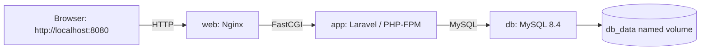

# Laravel Request System

## Brief Description

The Laravel Request System is a web application for managing and organizing user requests. It provides a Laravel-based foundation for submitting, tracking, and maintaining request records through a centralized system.

## Student Information

```text
CHUA, Kyla - Reviewer (inspects and tests the code)
SOLANO, Iris Claire D. - Driver (implements the change, maintains the policy, controller, routes, and views)

Course: BSIT
Year: 4th Year
Section: 4-3
```

## Software Requirements

- PHP
- Composer
- Laravel
- MySQL
- phpMyAdmin
- Git
- GitHub
- Web Browser

## Laravel Installation

Clone the repository and install its dependencies:

```powershell
git clone https://github.com/irisclairesolano/laravel_request_system.git
cd laravel-request-system
composer install
```

Create the environment file:

```powershell
cp .env.example .env
```

For Windows PowerShell, you can also use:

```powershell
Copy-Item .env.example .env
```

Generate the application key:

```powershell
php artisan key:generate
```

Configure the database connection in `.env`, including the database name, host, username, and password. Do not commit database passwords or other credentials to the repository.

Run the database migrations:

```powershell
php artisan migrate
```

## Database Name

```text
laravel-request-system
```

## Database Import Instructions

This project uses Laravel migrations, so the database structure can be recreated without importing a SQL file. After creating the database named `laravel-request-system` and configuring `.env`, run:

```powershell
php artisan migrate
```

## Team Setup

Team members can set up the project by following the Laravel Installation and Database Import Instructions above.

Make sure to:
- Use the database name `laravel-request-system`.
- Configure the local `.env` file with the correct MySQL settings.
- Run the required Laravel migrations.
- Do not commit the actual `.env` file because it may contain sensitive or local configuration.

## Request Data Model

The project includes a `requests` table for storing submitted requests.

### Migration

```powershell
php artisan make:migration create_requests_table
php artisan migrate
```

### Verification

```powershell
php artisan migrate:status
```

The `requests` table can also be inspected through phpMyAdmin.

### Request Fields

| Field | Type | Description |
| --- | --- | --- |
| id | bigint unsigned | Unique record identifier |
| requester_name | varchar(100) | Full name of the person submitting the request |
| requester_email | varchar(255) | Email address of the requester |
| item_name | varchar(150) | Name of the requested item |
| quantity | unsigned integer | Quantity requested |
| purpose | text | Reason or purpose for the request |
| status | varchar(20) | Request status, default `pending` |
| created_at | timestamp | Date and time the request was created |
| updated_at | timestamp | Date and time the request was last updated |

## User Stories

### Requester

As a requester, I want to submit a request with my information, requested item, quantity, and purpose, so that my request can be properly recorded and reviewed.

**Acceptance Criteria:**
- The requester must provide a name, email, item name, quantity, and purpose.
- The quantity must be greater than zero.
- A new request must have a default status of `pending`.

### Staff Reviewer

As a staff reviewer, I want to view the submitted request details and current status, so that I can properly review and process the request.

**Acceptance Criteria:**
- The staff reviewer can view the requester name, email, item, quantity, purpose, and status.
- Each request must have a unique ID.
- The request status must be available for checking.

### Record Keeper

As a record keeper, I want each request to have creation and update timestamps, so that I can track when a request was created or changed.

**Acceptance Criteria:**
- Each request must contain `created_at` and `updated_at`.
- Each request must be stored in the `requests` table.
- Each request must have a unique ID for identification.

## Request Authorization

All request routes require authentication. Students may create requests and list
only requests whose `user_id` matches their signed-in account. Request ownership
is determined by `user_id`, not by the requester name or email. Administrators
may list and view all requests, and may update a request status. Students cannot
set the owner, requester identity, role, or initial status: those values come
from the authenticated account and the server.

Every single-record read and status write is authorized on the server. A student
who requests another student's record receives **404 Not Found**, consistently,
so the response does not disclose whether that record exists. Other authorization
denials (including a student's status update) return **403 Forbidden**.

### Request Routes

| Method | Path | Access and behavior |
| --- | --- | --- |
| `GET` | `/requests` | Authenticated list; students see their own requests, administrators see all. |
| `POST` | `/requests` | Students create a request; server sets owner, requester identity, and `pending` status. |
| `GET` | `/requests/{serviceRequest}` | Owner or administrator only; another student's record returns 404. |
| `PATCH` | `/requests/{serviceRequest}/status` | Administrator only; accepts `pending`, `approved`, or `rejected`. |

Browser requests render escaped Blade pages and use CSRF-protected forms.
JSON clients can request JSON responses using the `Accept: application/json`
header. The status form uses PATCH method spoofing and submits through the same
authenticated, policy-protected route.

### File Responsibilities

| File | Responsibility |
| --- | --- |
| `app/Policies/ServiceRequestPolicy.php` | Defines list, view, create, and administrator status-update authorization. |
| `app/Providers/AppServiceProvider.php` | Explicitly registers the service-request model policy. |
| `app/Http/Controllers/ServiceRequestController.php` | Applies policy checks, validates allowlisted input, scopes lists by owner, and handles HTML/JSON responses. |
| `routes/web.php` | Declares authenticated request and profile routes under Laravel's `web` middleware, including CSRF protection. |
| `resources/views/requests/index.blade.php` | Displays the scoped list and student request form with `@csrf`. |
| `resources/views/requests/show.blade.php` | Displays escaped request details and the administrator status form with `@csrf` and `@method('PATCH')`. |
| `app/Models/ServiceRequest.php` | Maps the model to the `requests` table and explicitly allowlists assignable attributes. |
| `database/migrations/2026_09_30_215253_create_requests_table.php` | Defines Laboratory 2 request field types and lengths. |
| `database/migrations/2026_10_07_093407_add_user_id_to_requests_table.php` | Adds request ownership through `user_id`. |
| `tests/Feature/ServiceRequestAuthorizationTest.php` | Tests request policy, ownership scoping, creation, and status updates. |
| `tests/Feature/ServiceRequestAccessInputMatrixTest.php` | Exercises the T01–T10 access and input test cases. |
| `docs/LAB3-ACCESS-INPUT-TEST-MATRIX.md` | Records expected and actual results, pass/fail status, evidence, and live CSRF check instructions. |

## Verify the Requests Table

To verify that the `requests` table was created correctly:

1. Make sure the Laravel project is connected to MySQL.
2. Run:

```powershell
php artisan migrate
```

## Laboratory 3 Setup and Testing

Keep the Laboratory 1 database name, `laravel-request-system`, and configure
its local connection in `.env`. For a new local setup, create the database in
MySQL first, then run the migrations (and optional development seed data):

```powershell
Copy-Item .env.example .env
php artisan key:generate
php artisan migrate
php artisan db:seed
```

Do not run `migrate:fresh` against a database containing work you need; it
drops existing tables. Use the PHPUnit suite for automated checks:

```powershell
php artisan test
php artisan test --filter=ServiceRequestAccessInputMatrixTest
```

The matrix report documents all ten cases and results:
[`docs/LAB3-ACCESS-INPUT-TEST-MATRIX.md`](docs/LAB3-ACCESS-INPUT-TEST-MATRIX.md).
Laravel normally bypasses CSRF middleware during PHPUnit runs; reproduce the
missing/invalid token cases using the isolated SQLite database and live local
HTTP-server steps in that report, not the regular project database.

Before sharing or deploying, set `APP_DEBUG=false` in the deployed environment.
The tracked `.env.example` contains placeholders only; `.env` and common local
environment variants are excluded by `.gitignore`. Never include credentials,
SQL errors, or debug stack traces in screenshots.

## Run the Project

Start the Laravel development server:

```powershell
php artisan serve
```

Open the project in a web browser at:

http://127.0.0.1:8000

##laboratory 3 verification 


Verification instruction: Test administrator access and administrator-only status updates.

## Laboratory 4: Docker Containers

### Docker requirements

The container setup was verified with Docker 28.0.4 and Docker Compose v2.34.0
on Windows using Docker Desktop's Linux container engine. Use Docker Desktop
with Linux containers enabled, or another Docker Engine that supports Linux
containers, and the Docker Compose v2 plugin.

Check the installed versions from PowerShell:

```powershell
docker --version
docker compose version
```

### Container diagram and services



| Service | Purpose |
| --- | --- |
| `web` | Nginx serves the public files and forwards PHP requests to the app. It publishes port `8080` on localhost only. |
| `app` | Laravel running on PHP-FPM. The image installs production Composer dependencies and builds the frontend assets. |
| `db` | MySQL 8.4 database. Its health check must pass before the app starts. |
| `db_data` | Named Docker volume holding MySQL data outside the database container, so recreating containers does not remove records. |

### Environment configuration

Create a private local environment file from the checked-in example:

```powershell
Copy-Item .env.container.example .env.container
notepad .env.container
```

Replace the password placeholders with two different, unique local passwords.
Leave no placeholder in use for a real deployment. `.env.container` is ignored
by Git; commit only `.env.container.example`.

| Variable | Meaning |
| --- | --- |
| `APP_KEY` | Laravel encryption key. Generate it using the command below and paste the output into this file. |
| `DB_HOST` | Compose service name `db`, used by Laravel to find MySQL on the internal network. |
| `DB_DATABASE` | Database name used by Laravel; it must match the database Compose initializes. |
| `DB_USERNAME` | Application database user, not the MySQL root account. |
| `DB_PASSWORD` | Unique local password for the application database user. |
| `DB_ROOT_PASSWORD` | A different unique local password for MySQL administration and the database health check. |

The `.env.container.example` file contains placeholder values only. It does not
contain real passwords or a usable application key.

Validate the Compose configuration, build the image, and generate an
application key:

```powershell
docker compose --env-file .env.container config --quiet
docker compose --env-file .env.container build app
docker compose --env-file .env.container run --rm --no-deps app php artisan key:generate --show
```

Copy the generated key into `APP_KEY` in `.env.container` before starting the
application.

### Build and startup commands

From the repository folder, build and start all services:

```powershell
docker compose --env-file .env.container up -d --build
docker compose --env-file .env.container ps
```

Open <http://localhost:8080>. Since the configuration is in
`.env.container` rather than the default `.env`, include
`--env-file .env.container` on every Compose command.

### Migration and account setup commands

Apply database migrations and create the fictional development accounts:

```powershell
docker compose --env-file .env.container exec app php artisan migrate --force
docker compose --env-file .env.container exec app php artisan db:seed --class=UserSeeder --force
```

The local seeder creates Student 1 (`student1@example.com`), Student 2
(`student2@example.com`), and Administrator (`admin@example.com`). These
accounts are for local development only; do not use them in a deployed
environment. `UserSeeder` uses `updateOrCreate`, so running it again resets
these sample accounts to their seeded values.

To check the migration state:

```powershell
docker compose --env-file .env.container exec app php artisan migrate:status
```

### Health-check instructions

Check that the database reports `healthy` and the app and web services report
`Up`:

```powershell
docker compose --env-file .env.container ps
```

The `db` health check runs `mysqladmin ping`. Verify the HTTP endpoint too:

```powershell
curl.exe -fsS --max-time 120 http://localhost:8080/ -o NUL
```

If a service is unhealthy or the HTTP check fails, inspect its logs:

```powershell
docker compose --env-file .env.container logs --tail=100 db app web
```

### Persistence test results

The persistence test record `CONTAINER-PERSIST-01` was created by Student 1
and remained in the MySQL database after `docker compose down` followed by
`docker compose up -d`. The observed record was:

| Request ID | Student owner | Item name | Quantity | Status |
| --- | --- | --- | --- | --- |
| 4 | Student 1 (`student1@example.com`) | `CONTAINER-PERSIST-01` | 1 | `pending` |

The app container ID changed from prefix `8d0d295e596b` to
`9a53c6788cbc` during this test, while the request remained. The MySQL data
is stored in the `db_data` named volume. `docker compose down` preserves this
volume. Do not use `docker compose down -v` if you need to keep the database.

### Reproduction procedure

1. Clone the repository, change into its folder, and copy the example
   environment file as described above.
2. Set unique local database and root passwords, validate the Compose file,
   build the app image, generate an application key, and paste that key into
   `.env.container`.
3. Start the stack with
   `docker compose --env-file .env.container up -d --build`.
4. Run the migration and `UserSeeder` commands above. Check `docker compose
   --env-file .env.container ps` and open <http://localhost:8080>.
5. Sign in as a student, open the **Service Requests** navigation link, and
   create a request with item name `CONTAINER-PERSIST-01`, quantity `1`, and a
   short purpose. Record its ID, owner, item name, quantity, and status.
6. Record the app container ID:

   ```powershell
   $appId = docker compose --env-file .env.container ps -q app
   "Full app container ID: $appId"
   "First 12 characters: $($appId.Substring(0, 12))"
   ```

7. Recreate the containers without removing the database volume, then verify
   the request is still present:

   ```powershell
   docker compose --env-file .env.container down
   docker compose --env-file .env.container up -d
   docker compose --env-file .env.container ps
   docker compose --env-file .env.container exec app php artisan tinker --execute='dump(App\Models\ServiceRequest::all()->map(fn ($r) => [$r->id, $r->user_id, $r->item_name, $r->quantity, $r->status])->all());'
   ```

8. Find `CONTAINER-PERSIST-01` in the Tinker output and confirm its row
   matches the details recorded in step 5. The app container ID may have
   changed, while the row remains because the named database volume was
   preserved.

### Why credentials must not be stored in Docker images

Anyone who obtains an image can inspect its layers and build history. Images
are also copied to registries and other computers, making embedded credentials
easy to expose and difficult to revoke everywhere. Supply credentials at
runtime through a private environment file or a secrets manager; never copy
`.env` files, passwords, or private keys into an image or commit them to Git.

### S28 - README evidence

Capture screenshots of the rendered Laboratory 4 README section, preferably
from the GitHub repository page, and save them under `docs/screenshots/` as
the S28 evidence.
