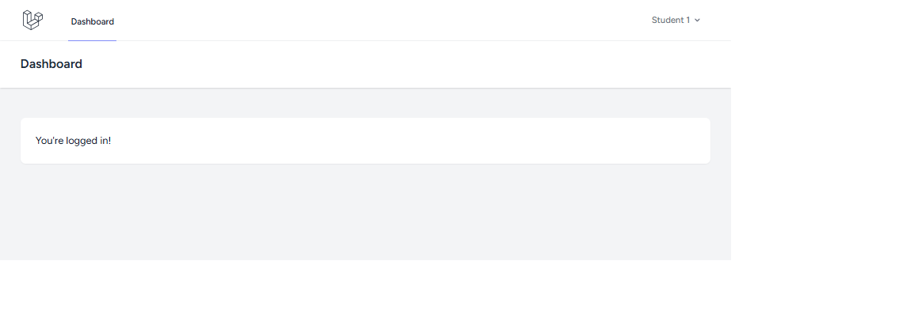
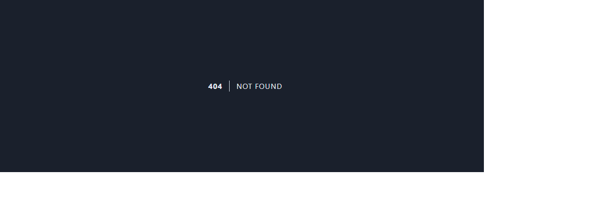
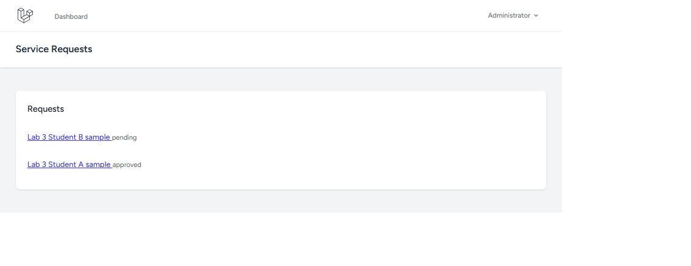
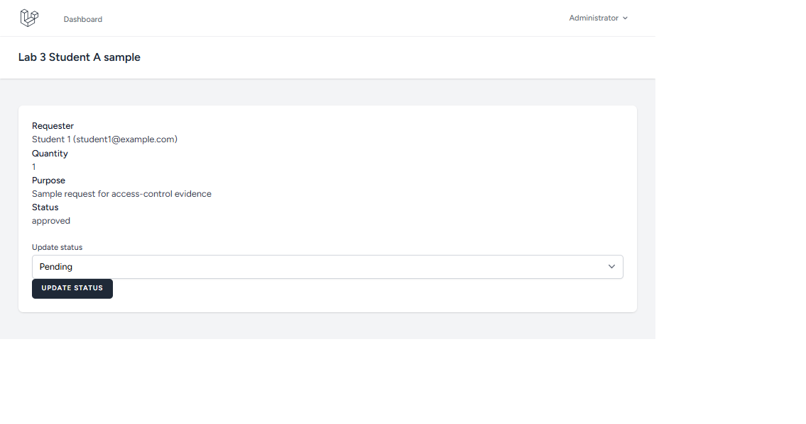
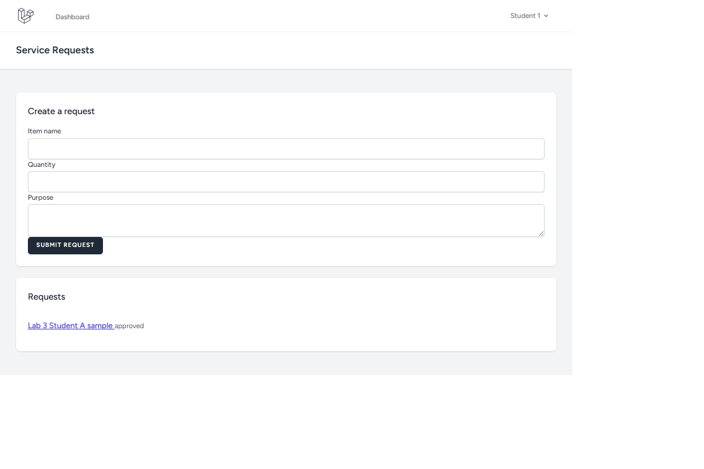

# Lab 3: S11-S16 Screenshot Evidence

## Test setup

The container database was seeded with two fictional requests for the access
tests. The seeded development accounts use the password `password`:

- Student A: `student1@example.com`
- Student B: `student2@example.com`
- Administrator: `admin@example.com`

Student A's request is ID `1`; Student B's is ID `2`. These requests are only
sample data for the Lab 3 evidence.

## Screenshots

The screenshots are saved in `docs/screenshots/`. Each one-line caption records
the observed result.

### S11 - Student login

Sign in as Student A and capture the successful logged-in page.

Who: Student A; What I did: signed in with the seeded student account; Expected: login succeeds and the student session is active; Happened: login succeeded and the dashboard displayed Student 1.

### S12 - Student A's request list

While signed in as Student A, open `/requests` and capture the list showing
Student A's submitted request.

Who: Student A; What I did: opened `/requests`; Expected: Student A sees only their own request; Happened: the list showed “Lab 3 Student A sample” with status `approved` and did not show Student B's request.

### S13 - Student B denied access to Student A's request

Sign out, sign in as Student B, and navigate directly to
`/requests/{Student A request ID}`. The application is configured to return
404 for another student's request.

Who: Student B; What I did: opened `/requests/1`; Expected: access is denied with a 404 page and request details are not shown; Happened: the app returned a 404 Not Found page.

### S14 - Administrator request list

Sign out, sign in as the administrator, open `/requests`, and capture the list
showing requests from both students.

Who: Administrator; What I did: opened `/requests`; Expected: the administrator sees requests from both students; Happened: the list showed both sample requests, with Student A's approved and Student B's pending.

### S15 - Administrator status update

As the administrator, open a student request, change its status to `approved`,
submit the form, and capture the page showing the saved status.

Who: Administrator; What I did: changed Student A's request status to `approved`; Expected: the status saves and is displayed as approved; Happened: the request detail page displayed status `approved`.

### S16 - Validation error

As a student, open `/requests`, enter otherwise valid request details, and
submit an invalid quantity such as `0`. If the browser blocks the value because
of the field's `min="1"` constraint, use the browser inspector to remove or
change that constraint for this test. Capture the validation message returned
by the application.

Who: Student A; What I did: submitted a request with quantity `0`; Expected: the application shows a quantity validation error and does not save the request; Happened: the app displayed “The quantity field must be at least 1.” and the database remained at two requests.
